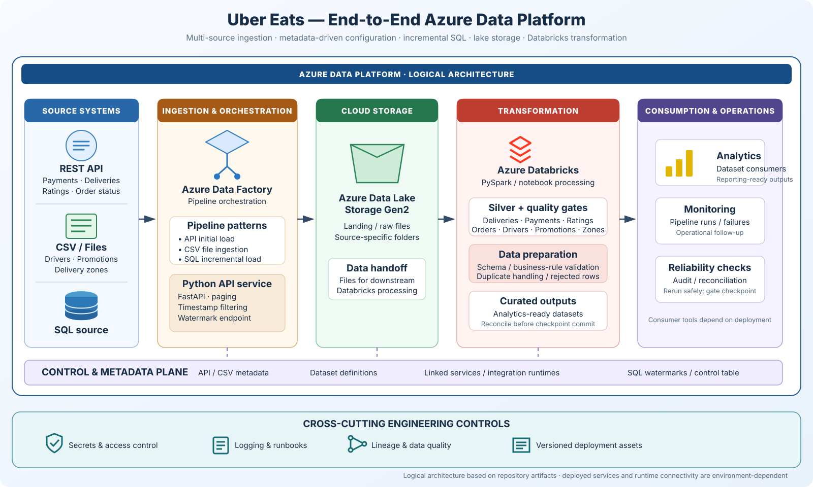
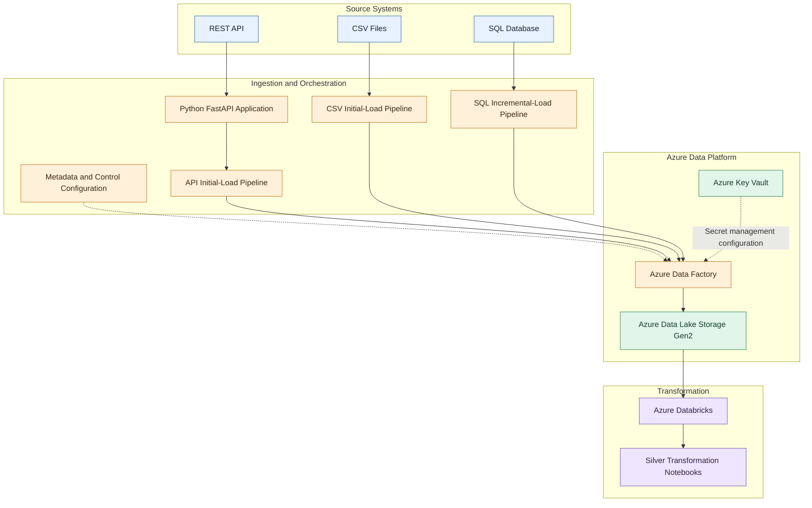

# Uber Eats — Metadata-Driven Azure Data Platform

A multi-source data engineering platform for restaurant-delivery analytics, combining REST API ingestion, CSV ingestion, SQL incremental extraction, Azure Data Factory orchestration, Azure Data Lake Storage, and Databricks transformations.


> **Project focus:** Multi-source ingestion, metadata-driven configuration, incremental loading, and cloud data-platform design.  
> **Owner:** Isaiah Nyakundi · [GitHub](https://github.com/viradidi) · [Portfolio](https://viradidi.github.io/)

This repository preserves the project's source code, exported Azure Data Factory resources, API and file metadata, sample domain data, and Databricks notebook exports. The diagrams describe the solution represented by those artifacts; the live status of Azure resources depends on the deployment environment.

## Overview

Data platforms must combine information from multiple sources while preserving data quality, supporting repeatable ingestion, and making data available for downstream processing.

This project brings together restaurant-delivery domain data, including payments, deliveries, order statuses, ratings, drivers, promotions, and delivery zones. It demonstrates how different source patterns can be organized into an Azure-oriented data engineering workflow.

The repository contains Python API application code, source sample data, metadata configurations, Azure Data Factory resource definitions, SQL-related assets, and Databricks notebook exports.

## Business Problem

A delivery platform needs a consistent way to ingest and process data originating from different systems.

Typical engineering challenges include:

- Ingesting data from REST API endpoints and CSV files.
- Supporting incremental extraction from SQL sources.
- Coordinating ingestion through reusable pipeline definitions.
- Organizing data in cloud storage for downstream processing.
- Applying transformations to delivery, payment, order-status, rating, and related datasets.
- Maintaining configuration and metadata separately from pipeline logic.
- Making the workflow understandable and reproducible for other engineers.

This project demonstrates technical patterns relevant to those challenges.

## Architecture

### End-to-end platform overview



The overview shows the three source patterns—REST API, CSV, and SQL—feeding Azure Data Factory orchestration and Azure Data Lake Storage, followed by Databricks Silver transformations and analytics-ready outputs. Metadata, control state, and secret management are supporting concerns rather than business-data layers.

### Logical component flow

The Mermaid view below complements the visual with repository-level component names. Exact runtime connectivity and deployed Azure resources depend on environment configuration.



**Diagram interpretation**

- **Sources:** REST API resources, CSV files, and a SQL source.
- **Ingestion:** Python API code and separate pipeline definitions for API, CSV, and SQL ingestion patterns.
- **Orchestration:** Azure Data Factory resource definitions and metadata configuration.
- **Storage:** Azure Data Lake Storage integration.
- **Transformation:** Databricks notebooks for Silver-layer processing.

The diagram is a logical view of the project artifacts, not proof that every connection is currently deployed or operational. Review the exported linked services and pipeline activities to confirm exact runtime behavior.

See [`architecture/architecture.md`](architecture/architecture.md) for component responsibilities, data-flow details, and deployment considerations.


## Engineering Evidence and Operational Readiness

This repository includes operational artifacts for reviewing and recovering the pipeline—not only ingestion and transformation code:

- [Incremental source contract](docs/INCREMENTAL_SOURCE_CONTRACT.md): per-table requirements for keys, watermarks, late-arriving changes, deletes, replay, and reconciliation.
- [SQL incremental-load review](docs/SQL_INCREMENTAL_LOAD_REVIEW.md): bounded extraction behavior, checkpoint ordering, and known correctness limitations.
- [Recovery and rerun runbook](docs/RECOVERY_AND_RERUN_RUNBOOK.md): failure triage, safe reruns, and checkpoint advancement gates.
- [Operations and reliability guide](docs/OPERATIONS_AND_RELIABILITY.md): operational reports, audit records, and recovery practices.
- [Operational health SQL](docs/OPERATIONAL_HEALTH_REPORT.sql), [quality trends SQL](docs/DATA_QUALITY_TRENDS_AND_INCIDENTS.sql), and [reconciliation audit SQL](docs/RECONCILIATION_AUDIT_QUERIES.sql).
- [Project completion and evidence checklist](docs/PROJECT_CHECKLIST.md).

The GitHub Actions workflow checks repository JSON/notebook validity, Python syntax, notebook portability, sample-data quality, API-key configuration, and static recovery contracts. These checks provide repository-level safeguards; they do not execute Azure Data Factory or Databricks workloads.

### Current validation boundary

The project artifacts are committed and can be reviewed in GitHub. Azure runtime validation is currently pending because the Azure for Students subscription is unavailable. In particular, source-specific watermark behavior, live ADF execution, Spark/Delta execution, and controlled failure/retry scenarios should not be described as cloud-verified until evidence is captured in an available environment.

## Technology Stack

| Technology | Role |
|---|---|
| Python | API application and ingestion-related logic |
| FastAPI | REST API application framework |
| Azure Data Factory | Pipeline orchestration and ingestion configuration |
| Azure Data Lake Storage Gen2 | Cloud storage integration |
| Azure SQL / SQL source | Relational source and incremental-loading patterns |
| Azure Databricks | Distributed data processing environment |
| PySpark / Spark | Notebook-based transformations, where used |
| JSON | Pipeline, dataset, linked-service, and metadata configuration |
| CSV | File-based source data |
| Git and GitHub | Version control and project documentation |

The table describes the technologies represented by the project artifacts. Confirm the exact execution environment and service configuration before treating each component as deployed.

## Data Domains

The repository contains assets associated with:

- Deliveries
- Payments
- Order statuses
- Ratings
- Drivers
- Promotions
- Delivery zones

The API metadata configuration references the `payments`, `deliveries`, `ratings`, and `order-status` resources.

The CSV metadata configuration references `drivers.csv`, `promotions.csv`, and `zones.csv`.

## Ingestion Patterns

### 1. REST API ingestion

Relevant assets include:

- `main.py`
- `api_metadata_v2 (2).json`
- `dataset/DS_api_metadata.json`
- `dataset/ds_api_src_control.json`
- `pipeline/api_src_inital load.json`

The API configuration describes several delivery-domain resources. The exported pipeline definition documents the intended API ingestion workflow.

### 2. CSV ingestion

Relevant assets include:

- `drivers.csv`
- `promotions.csv`
- `zones.csv`
- `csv_metadata_proper (2).json`
- `pipeline/csv_initial load.json`

The CSV metadata maps source files to logical destination folders.

### 3. SQL incremental ingestion

Relevant assets include:

- `pipeline/sql_incremental pipeline.json`
- SQL dataset and linked-service definitions
- SQL migration and incremental-loading documentation

The repository includes configuration and documentation for an incremental SQL ingestion pattern. Confirm the watermark, checkpoint, and restart behavior against the actual pipeline implementation before describing it as production-ready.

## Transformation Layer

The `notebooks/` directory contains Databricks notebook exports for datasets such as:

- Deliveries
- Drivers
- Order statuses
- Payments
- Promotions
- Ratings
- Zones

Both `.py` and `.ipynb` formats are present for several notebooks.

These artifacts represent the Silver transformation layer. Review the notebook logic to establish the exact cleansing rules, schema enforcement, deduplication behavior, and write strategy.

## Repository Structure

```text
.
├── architecture/
│   └── architecture.md
├── data/
│   ├── deliveries.json
│   ├── order_status.json
│   ├── payments.json
│   ├── ratings.json
│   └── watermarks.json
├── dataset/
├── docs/
├── factory/
├── integrationRuntime/
├── linkedService/
├── notebooks/
├── pipeline/
├── routing/
├── main.py
├── requirements.txt
├── publish_config.json
├── api_metadata_v2 (2).json
├── csv_metadata_proper (2).json
├── drivers.csv
├── promotions.csv
└── zones.csv
```

This is a representative overview. Refer to the repository tree for the complete list of files.

## Getting Started

### Prerequisites

Depending on which components you want to inspect or run, you may need:

- Python
- Git
- An Azure subscription with the required permissions
- Azure Data Factory
- Azure Data Lake Storage Gen2
- Azure Databricks
- Access to the configured SQL source
- Any required API source configuration

Cloud services may incur charges. Review pricing and resource usage before deploying.

### 1. Clone the repository

```bash
git clone https://github.com/viradidi/uber-eats-data-analytics-platform.git
cd uber-eats-data-analytics-platform
```

### 2. Install Python dependencies

Create and activate a virtual environment appropriate for your operating system.

```bash
python -m venv .venv
```

Windows CMD:

```bat
.venv\Scripts\activate
```

Install dependencies:

```bash
python -m pip install --upgrade pip
pip install -r requirements.txt
```

The current `requirements.txt` contains FastAPI and Uvicorn. Additional dependencies may be needed for individual scripts or notebooks.

### 3. Configure credentials securely

Do not commit credentials, tokens, passwords, storage account keys, or private connection strings.

The FastAPI mock source requires an `API_KEY` environment variable; the application intentionally has no built-in default key.

Windows CMD (for the current terminal session):

```bat
set API_KEY=replace-with-a-long-random-secret
uvicorn main:app --host 127.0.0.1 --port 10000
```

PowerShell:

```powershell
$env:API_KEY = "replace-with-a-long-random-secret"
uvicorn main:app --host 127.0.0.1 --port 10000
```

For cloud deployment, use Azure Key Vault or an approved secret-management mechanism and configure the application environment securely. Never commit the real key. Configure other resource names and connection details for your environment.

### 4. Inspect the Azure Data Factory resources

Review the JSON files in:

- `factory/`
- `pipeline/`
- `dataset/`
- `linkedService/`
- `integrationRuntime/`
- `routing/`

These files represent exported resource definitions. Validate linked services, integration runtimes, dataset references, parameters, and dependencies before importing or publishing them to an Azure environment.

### 5. Inspect Databricks notebooks

Open the notebook exports in `notebooks/` and review their source configuration, transformation logic, dependencies, and target locations before execution.

The Silver notebook exports use a Databricks widget named `bronze_root` to configure the Bronze storage root. Its default preserves the original project location; override it for another environment before running the notebook/job. Configure storage authentication separately through your approved Azure/Databricks identity or secret mechanism—do not put credentials in the widget. The shared column-standardization helper now lives in `src/common/spark_utils.py`, replacing a personal workspace-path dependency.

These changes improve portability at the code/configuration level. They do not establish that the notebooks have been executed successfully in a live Spark workspace; validate catalog/schema names, storage permissions, and runtime behavior in the target environment.

## Security and Data Handling

- Credentials should be supplied at runtime, not hard-coded into source files.
- Azure Key Vault integration should use appropriate identity and access controls.
- Storage and SQL access should follow least-privilege principles.
- Public sample data should be synthetic or explicitly approved for redistribution.
- Do not publish private datasets, customer records, or environment-specific secrets.
- Review exported linked-service JSON files before reusing them.

## Validation and Operational Considerations

Before treating this workflow as production-ready, validate:

- Schema and data-quality rules.
- Required-field and uniqueness constraints.
- Incremental extraction and watermark correctness.
- Idempotent writes and duplicate handling.
- Retry, failure, and restart behavior.
- Source-to-target reconciliation.
- Logging and pipeline monitoring.
- Permissions and secret rotation.
- Deployment and recovery procedures.

These are important validation areas; this README does not claim that every item is already implemented or tested.

## Implementation Status and Scope

This is an implemented portfolio project with API application code, source data, metadata and exported Azure Data Factory resources, SQL incremental-ingestion configuration, and Databricks Silver notebook artifacts. The repository is designed to demonstrate the architecture and implementation patterns across these components.

The repository contains exported cloud configuration, which is distinct from a currently running Azure deployment. Runtime behavior depends on valid linked services, integration runtimes, secrets, resource names, and workspace-specific paths. Describe deployment and execution evidence separately from source-code availability; do not infer live cloud status from checked-in JSON alone.

## Engineering Roadmap

The next improvements that would strengthen this platform further include:

- Automated data-quality and schema validation tests.
- Explicit watermark and checkpoint recovery tests.
- Source-to-target reconciliation reports.
- Centralized logging and pipeline observability.
- Automated deployment validation through CI/CD.
- Validate the configurable Bronze root and shared helper imports in a live Databricks workspace.
- Extend environment-specific configuration to catalog/schema names and orchestration parameters.
- Documented runbooks and recovery procedures.

These are suggested enhancements, not claims about existing functionality.

## Author

**Isaiah Nyakundi**

Data Engineering | Analytics Engineering | Cloud Data Platforms

GitHub: [@viradidi](https://github.com/viradidi)

Portfolio: [viradidi.github.io](https://viradidi.github.io/)

---

*This is a portfolio data platform built around Azure-oriented services and restaurant-delivery sample data. The repository documents the implementation artifacts; live deployment status is environment-dependent.*
