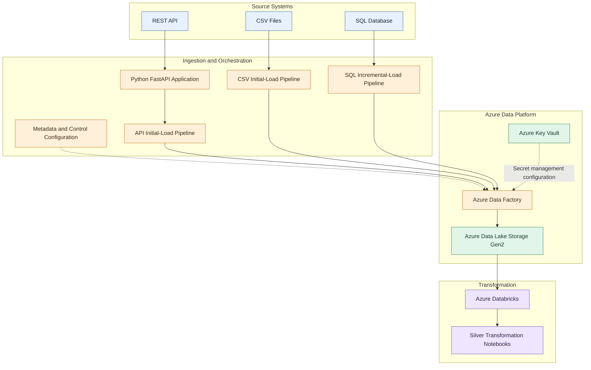

# Uber Eats — End-to-End Azure Data Engineering Platform

An end-to-end data engineering project demonstrating API ingestion, file-based ingestion, SQL incremental loading, Azure Data Factory orchestration, Azure Data Lake Storage integration, and Databricks Silver-layer transformations.

> **Project type:** Portfolio / learning project  
> **Platform:** Microsoft Azure  
> **Repository owner:** Isaiah Nyakundi

## Overview

Data platforms must combine information from multiple sources while preserving data quality, supporting repeatable ingestion, and making data available for downstream processing.

This project brings together restaurant-delivery domain data, including payments, deliveries, order statuses, ratings, drivers, promotions, and delivery zones. It demonstrates how different source patterns can be organized into an Azure-oriented data engineering workflow.

The repository contains Python API application code, source sample data, metadata configurations, Azure Data Factory resource definitions, SQL-related assets, and Databricks notebook exports.

## Business Problem

A delivery platform needs a consistent way to ingest and process data originating from different systems.

Typical engineering challenges include:

- Ingesting data from REST API endpoints and CSV files.
- Supporting incremental extraction from SQL sources.
- Coordinating ingestion through reusable pipeline definitions.
- Organizing data in cloud storage for downstream processing.
- Applying transformations to delivery, payment, order-status, rating, and related datasets.
- Maintaining configuration and metadata separately from pipeline logic.
- Making the workflow understandable and reproducible for other engineers.

This project demonstrates technical patterns relevant to those challenges.

## Architecture

The architecture below represents the major components evidenced by the repository. Exact runtime connectivity, storage paths, and deployed Azure resources depend on the corresponding configurations and environment.



**Diagram interpretation**

- **Sources:** REST API resources, CSV files, and a SQL source.
- **Ingestion:** Python API code and separate pipeline definitions for API, CSV, and SQL ingestion patterns.
- **Orchestration:** Azure Data Factory resource definitions and metadata configuration.
- **Storage:** Azure Data Lake Storage integration.
- **Transformation:** Databricks notebooks for Silver-layer processing.

The diagram is a logical view of the project artifacts, not proof that every connection is currently deployed or operational. Review the exported linked services and pipeline activities to confirm exact runtime behavior.

See [`architecture/architecture.md`](architecture/architecture.md) for the detailed architecture document.

## Technology Stack

| Technology | Role |
|---|---|
| Python | API application and ingestion-related logic |
| FastAPI | REST API application framework |
| Azure Data Factory | Pipeline orchestration and ingestion configuration |
| Azure Data Lake Storage Gen2 | Cloud storage integration |
| Azure SQL / SQL source | Relational source and incremental-loading patterns |
| Azure Databricks | Distributed data processing environment |
| PySpark / Spark | Notebook-based transformations, where used |
| JSON | Pipeline, dataset, linked-service, and metadata configuration |
| CSV | File-based source data |
| Git and GitHub | Version control and project documentation |

The table describes the technologies represented by the project artifacts. Confirm the exact execution environment and service configuration before treating each component as deployed.

## Data Domains

The repository contains assets associated with:

- Deliveries
- Payments
- Order statuses
- Ratings
- Drivers
- Promotions
- Delivery zones

The API metadata configuration references the `payments`, `deliveries`, `ratings`, and `order-status` resources.

The CSV metadata configuration references `drivers.csv`, `promotions.csv`, and `zones.csv`.

## Ingestion Patterns

### 1. REST API ingestion

Relevant assets include:

- `main.py`
- `api_metadata_v2 (2).json`
- `dataset/DS_api_metadata.json`
- `dataset/ds_api_src_control.json`
- `pipeline/api_src_inital load.json`

The API configuration describes several delivery-domain resources. The exported pipeline definition documents the intended API ingestion workflow.

### 2. CSV ingestion

Relevant assets include:

- `drivers.csv`
- `promotions.csv`
- `zones.csv`
- `csv_metadata_proper (2).json`
- `pipeline/csv_initial load.json`

The CSV metadata maps source files to logical destination folders.

### 3. SQL incremental ingestion

Relevant assets include:

- `pipeline/sql_incremental pipeline.json`
- SQL dataset and linked-service definitions
- SQL migration and incremental-loading documentation

The repository includes configuration and documentation for an incremental SQL ingestion pattern. Confirm the watermark, checkpoint, and restart behavior against the actual pipeline implementation before describing it as production-ready.

## Transformation Layer

The `notebooks/` directory contains Databricks notebook exports for datasets such as:

- Deliveries
- Drivers
- Order statuses
- Payments
- Promotions
- Ratings
- Zones

Both `.py` and `.ipynb` formats are present for several notebooks.

These artifacts represent the Silver transformation layer. Review the notebook logic to establish the exact cleansing rules, schema enforcement, deduplication behavior, and write strategy.

## Repository Structure

```text
.
├── architecture/
│   └── architecture.md
├── data/
│   ├── deliveries.json
│   ├── order_status.json
│   ├── payments.json
│   ├── ratings.json
│   └── watermarks.json
├── dataset/
├── docs/
├── factory/
├── integrationRuntime/
├── linkedService/
├── notebooks/
├── pipeline/
├── routing/
├── main.py
├── requirements.txt
├── publish_config.json
├── api_metadata_v2 (2).json
├── csv_metadata_proper (2).json
├── drivers.csv
├── promotions.csv
└── zones.csv
```

This is a representative overview. Refer to the repository tree for the complete list of files.

## Getting Started

### Prerequisites

Depending on which components you want to inspect or run, you may need:

- Python
- Git
- An Azure subscription with the required permissions
- Azure Data Factory
- Azure Data Lake Storage Gen2
- Azure Databricks
- Access to the configured SQL source
- Any required API source configuration

Cloud services may incur charges. Review pricing and resource usage before deploying.

### 1. Clone the repository

```bash
git clone https://github.com/viradidi/uber-eats-data-analytics-platform.git
cd uber-eats-data-analytics-platform
```

### 2. Install Python dependencies

Create and activate a virtual environment appropriate for your operating system.

```bash
python -m venv .venv
```

Windows CMD:

```bat
.venv\Scripts\activate
```

Install dependencies:

```bash
python -m pip install --upgrade pip
pip install -r requirements.txt
```

The current `requirements.txt` contains FastAPI and Uvicorn. Additional dependencies may be needed for individual scripts or notebooks.

### 3. Configure credentials securely

Do not commit credentials, tokens, passwords, storage account keys, or private connection strings.

Use environment variables, Azure Key Vault, or the relevant platform's secret-management mechanism. Configure resource names and connection details for your own environment.

The actual required environment variables must be confirmed from the application and pipeline definitions before running the project.

### 4. Inspect the Azure Data Factory resources

Review the JSON files in:

- `factory/`
- `pipeline/`
- `dataset/`
- `linkedService/`
- `integrationRuntime/`
- `routing/`

These files represent exported resource definitions. Validate linked services, integration runtimes, dataset references, parameters, and dependencies before importing or publishing them to an Azure environment.

### 5. Inspect Databricks notebooks

Open the notebook exports in `notebooks/` and review their source configuration, transformation logic, dependencies, and target locations before execution.

Some notebooks may require changes to match your workspace, catalog, schema, storage paths, and compute configuration.

## Security and Data Handling

- Credentials should be supplied at runtime, not hard-coded into source files.
- Azure Key Vault integration should use appropriate identity and access controls.
- Storage and SQL access should follow least-privilege principles.
- Public sample data should be synthetic or explicitly approved for redistribution.
- Do not publish private datasets, customer records, or environment-specific secrets.
- Review exported linked-service JSON files before reusing them.

## Validation and Operational Considerations

Before treating this workflow as production-ready, validate:

- Schema and data-quality rules.
- Required-field and uniqueness constraints.
- Incremental extraction and watermark correctness.
- Idempotent writes and duplicate handling.
- Retry, failure, and restart behavior.
- Source-to-target reconciliation.
- Logging and pipeline monitoring.
- Permissions and secret rotation.
- Deployment and recovery procedures.

These are important validation areas; this README does not claim that every item is already implemented or tested.

## Current Scope and Limitations

This repository documents the available Azure data engineering artifacts and transformation notebooks.

The presence of exported configurations alone does not establish that the entire workflow has been deployed successfully, that all services are connected, or that the pipeline has passed production acceptance tests.

Before extending the project, document:

1. Which Azure resources have been deployed.
2. Which ingestion and transformation pipelines have been executed successfully.
3. Which data-quality and reconciliation tests have passed.
4. Which downstream analytics products are included.
5. Which components remain environment-dependent or incomplete.

No production-readiness, business-impact, or performance claims should be made without supporting evidence.

## Future Improvements

Potential engineering extensions include:

- Automated data-quality and schema validation tests.
- Explicit watermark and checkpoint recovery tests.
- Source-to-target reconciliation reports.
- Centralized logging and pipeline observability.
- Automated deployment validation through CI/CD.
- Environment-specific configuration for development and production.
- Documented runbooks and recovery procedures.

These are suggested enhancements, not claims about existing functionality.

## Author

**Isaiah Nyakundi**

Data Engineering | Analytics Engineering | Cloud Data Platforms

GitHub: [@viradidi](https://github.com/viradidi)

Portfolio: [viradidi.github.io](https://viradidi.github.io/)

---

*This is a portfolio project intended to demonstrate data engineering patterns using Azure-oriented tools and sample domain data.*
