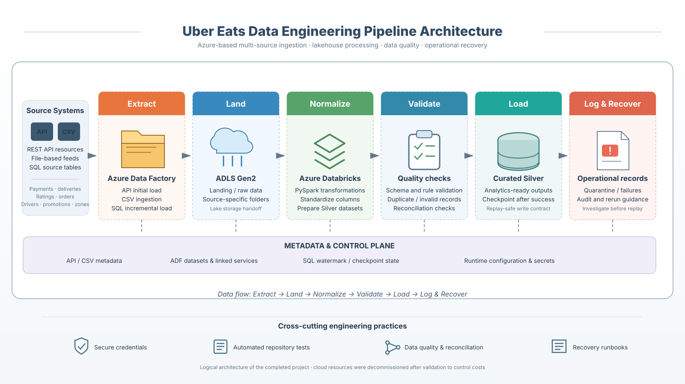

# Uber Eats Data Engineering Platform

An Azure-oriented data engineering project demonstrating API, CSV, and SQL ingestion, Silver transformations, a downstream Gold analytics layer, incremental-load controls, data quality, and operational recovery using synthetic restaurant-delivery domain data.

**Project owner:** Isaiah Nyakundi  
**Focus:** Data Engineering · Cloud Data Platforms · Analytics Engineering  
**Repository:** https://github.com/viradidi/uber-eats-data-analytics-platform

> **Project status:** The original API/CSV/SQL ingestion and Silver implementation were successfully executed end to end in the original Azure environment, as confirmed by the project owner. Those Azure resources were later decommissioned to control costs. The Gold transformations and master ADF orchestration are newer repository enhancements. The local-mode PySpark suite has since passed in GitHub Actions (94 tests in [run 41846175735](https://github.com/viradidi/uber-eats-data-analytics-platform/actions/runs/41846175735)); this validates the tested transformations against synthetic data, not a live Databricks job or ADF deployment. The newer Gold cloud deployment and latest SQL ADF hardening still require a fresh Azure acceptance run.

---

## 1. Project overview

Restaurant-delivery platforms generate data across operational systems: payments, deliveries, order statuses, ratings, drivers, promotions, and delivery zones. These datasets arrive through different interfaces and require consistent ingestion, storage, transformation, and operational controls.

This project brings together three ingestion patterns:

- **REST API:** operational resources exposed through a Python FastAPI mock source.
- **CSV files:** file-based datasets such as drivers, promotions, and delivery zones.
- **SQL:** an incremental extraction pattern using source watermarks and a control table.

Azure Data Factory coordinates the ingestion workflows. API and CSV Silver processing use repository-owned Databricks notebook dispatchers; the SQL Silver branch retains its external Databricks Job dependency. Data is landed in Azure Data Lake Storage Gen2 and processed through Azure Databricks/Spark transformations. A downstream Gold layer now builds order, payment, driver, and restaurant-feedback analytics for SQL-based business reporting.

The project also includes engineering controls and supporting documentation for incremental-load correctness, checkpoint handling, data quality, reconciliation, security considerations, and recovery.

## 2. Architecture



### High-level data flow

1. **Sources:** REST API resources, CSV files, and a relational SQL source.
2. **Ingestion:** API, CSV, and SQL ingestion patterns are represented by separate Azure Data Factory pipeline exports.
3. **Configuration:** metadata, datasets, linked services, and a factory-level Bronze root parameter support orchestration.
4. **Storage:** Azure Data Lake Storage Gen2 provides the lake storage integration and landing area.
5. **Transformation:** Azure Databricks notebook exports implement Silver-layer processing using Spark.
6. **Gold analytics:** A downstream Gold notebook builds order-level, daily performance, payment-method, driver, and restaurant-feedback tables.
7. **Operational controls:** SQL reports, quality/reconciliation utilities, checkpoint logic, and runbooks support validation and recovery.

The diagram and exported definitions describe the implemented project architecture. They are not a claim that the Azure resources remain deployed today.

For component-level detail, see [Architecture documentation](architecture/architecture.md).

## 3. Technology stack

| Technology | Role in the project |
|---|---|
| Python | API application and supporting utilities |
| FastAPI | Mock REST API source |
| Azure Data Factory | Ingestion orchestration and pipeline configuration |
| Azure Data Lake Storage Gen2 | Data lake storage integration |
| Azure Databricks | Distributed transformation environment |
| Apache Spark / PySpark | Silver and Gold transformations plus local Spark tests |
| SQL | Relational source extraction, control logic, reconciliation, and operational queries |
| JSON / CSV | Resource configuration, metadata, and source fixtures |
| GitHub Actions | Automated repository validation |

## 4. Engineering work demonstrated

### Multi-source ingestion

The repository contains separate ingestion patterns for API resources, CSV files staged in ADLS Gen2, and SQL-based incremental extraction. The FastAPI application provides paginated endpoints, timestamp-based filtering, API-key authentication, watermark information, and a controlled payment test-data endpoint.

### Metadata-driven orchestration

Azure Data Factory exports define pipeline, dataset, linked-service, and integration-runtime resources. Metadata separates source and destination configuration from parts of the pipeline logic and supports reusable ingestion patterns.

### Incremental extraction and checkpoint control

The SQL incremental-load design uses a lower watermark and a captured upper watermark to define a bounded extraction interval. The exported pipeline orders checkpoint advancement after the required downstream Silver job succeeds. It also includes pipeline concurrency configuration and a transactional compare-and-swap checkpoint update that rolls back on a stale or non-unique control-row match.

The SQL pipeline now processes only `pipeline_control` rows marked `is_active = 1`; a pre-loop metadata check rejects null/duplicate control IDs across the control table and duplicate active source mappings with `SQL_DUPLICATE_ACTIVE_CONTROL_METADATA`, and a separate guard fails with `SQL_NO_ACTIVE_CONTROL_ROWS` when none are enabled, rather than allowing the master pipeline to publish Gold after a no-op SQL branch. It validates the configured schema, table, watermark column, identifier syntax, and datetime-family cursor type before querying a source. It also fails closed when a source has null watermark values. Source queries honor the configured schema. The SQL output dataset supplies a deterministic `.csv` filename from the control ID and watermark interval; the sink extension is also set to `.csv` for consistency. ADF uses the explicit dataset filename when configured, so this does not by itself prove replay-safe overwrites ([ADF file naming behavior](https://learn.microsoft.com/en-us/azure/data-factory/format-delimited-text)). The control dataset uses a `datetime2(7)` checkpoint contract. Apply the [non-destructive checkpoint precision migration](sql/migrations/20261104_widen_pipeline_checkpoint_to_datetime2_7.sql) before deploying that updated contract.

These controls reduce specific failure and concurrency risks, but a watermark alone does not guarantee complete change capture. The strict lower boundary still does not capture equal/older late arrivals or hard deletes. A per-source overlap or CDC strategy must be paired with a known business key and replay-safe Silver merge before it is enabled. The ADF SQL branch invokes external Databricks job ID `121055824417886`; its SQL Silver job definition/notebook is not included in this repository, so verify its target write mode, merge keys, and same-interval replay behavior before claiming SQL destination idempotency.

For API endpoints, timestamped landing snapshots accumulate in the endpoint folders. The API Silver notebooks now use a shared PySpark replay helper: exact snapshot replays are collapsed, payment/delivery/rating entities retain the greatest source `updated_at`, and order-status history uses the composite event key `(order_id, status_timestamp)`. Conflicting payloads with the same key and source version fail before publication. This does not remove the separate late/equal-watermark and delete limitations in the SQL incremental source pattern.

See:
- [SQL incremental-load review](docs/SQL_INCREMENTAL_LOAD_REVIEW.md)
- [Incremental source contract](docs/INCREMENTAL_SOURCE_CONTRACT.md)
- [Checkpoint concurrency contract](docs/CHECKPOINT_CONCURRENCY_CONTRACT.md)

### Transformation and data quality

Databricks notebook exports cover delivery-domain datasets in the Silver layer. A shared PySpark transformation module publishes five Gold analytics tables, and a read-only SQL pack provides daily KPIs, order drill-through, payment analysis, driver performance, and restaurant feedback. Before publication, Gold inputs are checked for valid keys, timestamps, status values, numeric measures, and driver references. Gold outputs are checked for documented grain, KPI bounds, order-count reconciliation, and successful-payment reconciliation across order, daily, and payment-method datasets. Operational SQL reports for quality and reconciliation remain separate.

### Recovery and operational thinking

The project documents failure triage, rerun decisions, checkpoint safety, reconciliation, and evidence preservation. These materials make failure handling and operational trade-offs part of the design rather than treating a successful ingestion as the only measure of pipeline correctness.

See the [recovery and rerun runbook](docs/RECOVERY_AND_RERUN_RUNBOOK.md) and [operations and reliability guide](docs/OPERATIONS_AND_RELIABILITY.md).

## 5. Repository guide

| Path | Contents |
|---|---|
| `main.py` | FastAPI mock source application |
| `data/` | Synthetic JSON source data and watermark fixtures |
| `pipeline/` | Azure Data Factory pipeline exports |
| `dataset/` | Dataset definitions |
| `linkedService/` | Linked-service configuration exports |
| `factory/`, `routing/` | Data Factory factory settings and repository-owned API/CSV notebook dispatchers |
| `notebooks/` | Databricks notebook exports for Silver and Gold transformations |
| `src/gold/` | Reusable Spark transformations for Gold analytics |
| `reports/` | Business analytics SQL reporting pack |
| `src/common/` | Shared Spark utilities |
| `architecture/` | Architecture diagram and documentation |
| `docs/` | Source contracts, Gold definitions, runbooks, run-evidence guidance, reconciliation, and project handoff material |
| `.github/workflows/` | GitHub Actions validation workflow |
| `tests/` | Automated repository and application tests |

## 6. Run the local API

The local FastAPI application provides a mock source for exploring the API ingestion pattern. Running this component locally does not deploy the Azure Data Factory, ADLS, or Databricks resources.

### Prerequisites

- Python 3.10+ (the repository CI workflow uses Python 3.11)
- Git

### Clone and install

```bash
git clone https://github.com/viradidi/uber-eats-data-analytics-platform.git
cd uber-eats-data-analytics-platform

python -m venv .venv
```

Activate the environment:

**Windows CMD**
```bat
.venv\Scripts\activate
```

**PowerShell**
```powershell
.\.venv\Scripts\Activate.ps1
```

**macOS / Linux**
```bash
source .venv/bin/activate
```

Install dependencies:

```bash
python -m pip install --upgrade pip
python -m pip install -r requirements-test.txt
```

The test requirements include the API dependencies and PySpark 3.5.2. Java 17 is required for local Spark tests. Use requirements.txt alone when you only need to run the mock API.

### Configure the API key

The API intentionally fails closed if `API_KEY` is not configured. Set a local development value in your terminal; do not commit real credentials.

**Windows CMD**
```bat
set API_KEY=replace-with-a-local-development-secret
```

**PowerShell**
```powershell
$env:API_KEY = "replace-with-a-local-development-secret"
```

**macOS / Linux**
```bash
export API_KEY="replace-with-a-local-development-secret"
```

Start the API:

```bash
uvicorn main:app --host 127.0.0.1 --port 10000
```

The interactive API documentation is available at `http://127.0.0.1:10000/docs`.

Authenticated endpoints require the `X-API-Key` header. The application includes `/payments`, `/deliveries`, `/ratings`, `/order-status`, `/watermarks`, and `/payments/generate-test-data`. The test-data endpoint modifies the local payments JSON fixture and is intended for controlled demonstrations, not concurrent production writes.

## 7. Run automated tests

From the repository root:

```bash
python -m unittest discover -s tests -v
```

The GitHub Actions workflow also checks JSON and notebook validity, Python syntax, notebook code-cell syntax, Silver/Gold notebook portability, ADF orchestration contracts, API behavior, and the Gold transformations through local-mode PySpark tests. It uploads the test log as a 90-day workflow artifact.

The local Spark tests execute PySpark transformations against in-memory synthetic DataFrames. ADF tests inspect the exported JSON and dependency ordering; these static checks do not, by themselves, execute Azure Data Factory pipelines. They do not execute Azure Data Factory itself, and neither test type proves a live Databricks workspace run.

See the [GitHub Actions workflow history](https://github.com/viradidi/uber-eats-data-analytics-platform/actions).

## 8. Validation status and deployment boundary

The project owner confirms that the original ingestion and Silver implementation ran end to end successfully before the cloud environment was decommissioned to avoid ongoing costs. The Gold layer and master ADF orchestration are newer additions and still require redeployment and live validation.

The following distinction is important when reviewing the repository:

| What remains available | What is not currently implied |
|---|---|
| Application source code and synthetic fixtures | A continuously running API deployment |
| Exported Azure Data Factory resource definitions | A currently deployed ADF factory |
| Databricks Silver and Gold notebook exports, shared utilities, and local Spark tests | A currently available Databricks workspace or live job |
| Automated API, repository, and local PySpark tests plus ADF static-contract checks | Proof that every cloud service is executing now |
| Architecture, source contracts, SQL reviews, and runbooks | Independent production certification or an ongoing production SLA |

Historical end-to-end validation is the project owner's reported completion status. Current cloud availability is a separate matter. Where retained run IDs, logs, screenshots, or reconciliation outputs are available, they can provide additional evidence of the historical execution.

## 9. Security and responsible use

- Keep API keys, passwords, tokens, and connection strings out of source control.
- Use managed identities and an approved secret store such as Azure Key Vault for cloud workloads where supported.
- Apply least-privilege access to storage, SQL, orchestration, and compute resources.
- Treat exported linked-service definitions as configuration artifacts and review them before reuse.
- Use synthetic or approved sample data; do not publish real customer or payment information.
- Review the SQL incremental-load source contract before enabling a new source table.

## 10. Further technical documentation

- [Architecture and component responsibilities](architecture/architecture.md)
- [Gold layer and business reporting](docs/GOLD_LAYER_AND_REPORTING.md)
- [Run evidence and retention](docs/RUN_EVIDENCE_RETENTION.md)
- [Gold SQL reporting pack](reports/GOLD_ANALYTICS_REPORTING.sql)
- [SQL incremental-load review](docs/SQL_INCREMENTAL_LOAD_REVIEW.md)
- [Incremental source contract](docs/INCREMENTAL_SOURCE_CONTRACT.md)
- [Checkpoint concurrency contract](docs/CHECKPOINT_CONCURRENCY_CONTRACT.md)
- [Recovery and rerun runbook](docs/RECOVERY_AND_RERUN_RUNBOOK.md)
- [Operations and reliability guide](docs/OPERATIONS_AND_RELIABILITY.md)
- [Reconciliation audit queries](docs/RECONCILIATION_AUDIT_QUERIES.sql)
- [Data quality trends and incidents](docs/DATA_QUALITY_TRENDS_AND_INCIDENTS.sql)
- [Final project handoff](docs/FINAL_HANDOFF.md)
- [Portfolio evidence pack](docs/PORTFOLIO_EVIDENCE.md)
- [Project release gate](docs/PROJECT_RELEASE_GATE.md)
- [Consolidated release-readiness review](docs/RELEASE_READINESS_REVIEW.md)
- [External SQL Silver job review](docs/EXTERNAL_SQL_SILVER_JOB_REVIEW.md)
- [Restored Azure acceptance plan](docs/RESTORED_AZURE_ACCEPTANCE_PLAN.md)
- [Restored Azure configuration inventory](docs/RESTORED_AZURE_CONFIGURATION_INVENTORY.md)
- [ADF control-table bootstrap migration](sql/migrations/20261104_create_ingestion_control_tables.sql)
- [ADLS metadata and CSV staging scripts](deployment/azure/)

---

## About the author

**Isaiah Nyakundi**  
Data Engineer · Cloud Engineer · Analytics Engineer

- GitHub: https://github.com/viradidi
- Portfolio: https://viradidi.github.io/

