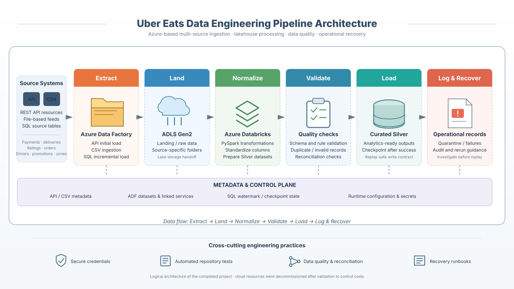

# Uber Eats Data Platform — Architecture Overview

## Business purpose

Bring operational data from API, CSV, and relational SQL sources into a structured data workflow for downstream analytics preparation.

## Canonical architecture

The canonical visual architecture remains the [end-to-end architecture diagram](uber-eats-end-to-end-architecture.svg), which is preserved as the original ingestion-through-Silver view. This document also describes the newer downstream Gold analytics extension; the SVG itself has not been redrawn.

## End-to-end flow

1. **Source systems:** REST API resources (payments, deliveries, ratings, and order status), CSV datasets (drivers, promotions, and delivery zones), and a relational SQL source.
2. **Extract and orchestrate:** Azure Data Factory coordinates the configured API, CSV, and SQL ingestion patterns using pipeline, dataset, linked-service, and metadata exports.
3. **Land:** source data is written to the configured Azure Data Lake Storage Gen2 landing area.
4. **Normalize:** Azure Databricks and PySpark notebook exports process landed datasets and prepare Silver-layer outputs.
5. **Validate:** implemented schema, required-field, key, domain, quality, quarantine, and reconciliation controls validate data according to each dataset's processing path.
6. **Gold analytics:** a downstream notebook builds order 360, daily order performance, payment-method performance, restaurant feedback, and driver performance datasets from Silver.
7. **Load and operate:** successful Silver outputs are published; SQL incremental progress is advanced only after the required downstream processing succeeds. Operational SQL, business reporting SQL, failure logging, and runbooks support investigation and analysis.

## Metadata and control plane

The data flow is supported by API/CSV metadata, ADF datasets and linked services, integration-runtime configuration, SQL watermark/checkpoint state, and environment-specific runtime configuration and secrets.

## Engineering considerations

- Incremental extraction uses a bounded lower/upper watermark interval, but source cursor semantics determine whether late updates, equal values, and deletes can be captured reliably.
- Pipeline concurrency and compare-and-swap checkpoint updates protect specific concurrency boundaries; they do not coordinate unrelated writers or guarantee idempotent writes by themselves.
- Data-quality checks, quarantine, and reconciliation help detect invalid or inconsistent outputs.
- Recovery requires inspecting partial writes and checkpoint state before replaying a batch.
- Credentials belong in secure runtime configuration, not committed source files.

See [the detailed architecture explanation](architecture.md), the [Gold layer and reporting guide](../docs/GOLD_LAYER_AND_REPORTING.md), the [incremental source contract](../docs/INCREMENTAL_SOURCE_CONTRACT.md), and the [recovery runbook](../docs/RECOVERY_AND_RERUN_RUNBOOK.md).

## Deployment boundary

The original ingestion/Silver platform was successfully executed in its original Azure environment, as confirmed by the project owner; those resources were later decommissioned to control costs. The Gold extension and master ADF pipeline are newer repository additions awaiting a fresh cloud rerun. The diagram and exported definitions do not imply that Azure resources are currently deployed or live.
