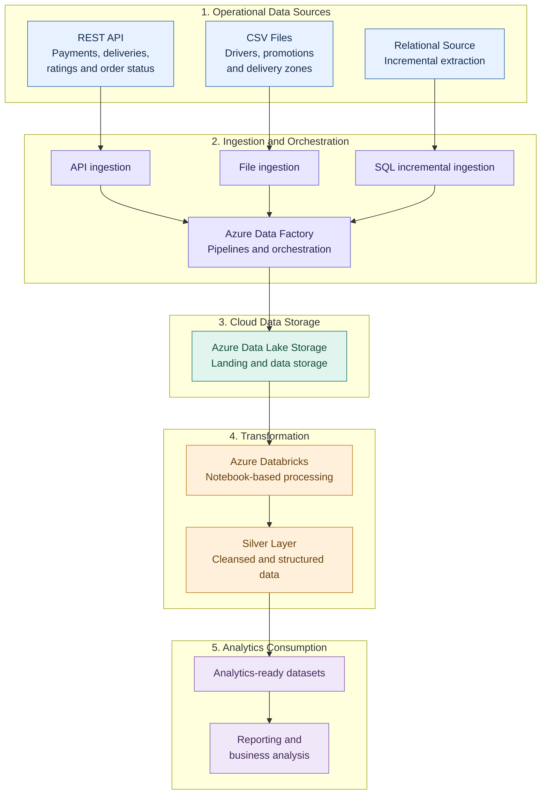

# Uber Eats Data Platform — Architecture Overview

## Business purpose

Bring operational data from different source systems into a structured data workflow so it can be prepared for consistent analytics and reporting.

## Logical architecture

## How to read the architecture

1. **Sources:** Operational records arrive through APIs, files, and relational data sources.
2. **Ingestion:** Azure Data Factory organizes the configured ingestion workflows.
3. **Storage:** Azure Data Lake Storage provides the cloud storage layer.
4. **Transformation:** Databricks notebooks process data into a structured Silver layer.
5. **Consumption:** The resulting datasets provide a foundation for downstream analytics and reporting.

## Engineering considerations

- Incremental extraction must define reliable extraction boundaries.
- Reprocessing should avoid unintended duplicate records.
- Data-quality checks and reconciliation help establish output correctness.
- Failures need a documented recovery approach.
- Monitoring and security depend on the deployed configuration and available execution evidence.

## Architecture boundary

This diagram represents the **logical architecture** of the project, not proof that every component is deployed and connected in a live production environment. Refer to the repository's pipeline definitions, notebooks, and execution evidence for implementation details.