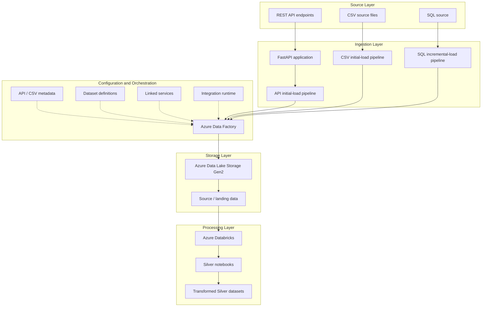

# Architecture — Uber Eats Data Engineering Platform

## 1. Purpose

This document describes the logical architecture represented by the repository's Python application, Azure Data Factory JSON exports, storage and SQL configurations, metadata files, and Databricks notebook exports.

The architecture separates ingestion concerns from orchestration, storage, and transformation.

**Important:** The diagram describes the intended flow indicated by the available artifacts. Validate the actual deployed resources, activity dependencies, connection settings, and execution results before treating it as a verified runtime architecture.

## 2. Logical Architecture

## 3. Component Responsibilities

### Source systems

The project represents three ingestion patterns:

- REST API resources for payments, deliveries, ratings, and order status.
- CSV files for drivers, promotions, and delivery zones.
- A relational SQL source for incremental extraction.

### Python application

`main.py` contains a FastAPI application. API metadata files describe resource paths and target-folder conventions.

Review authentication, route behavior, sample-data handling, and environment-variable configuration before deploying the application.

### Azure Data Factory

The repository contains separate pipeline definitions for API ingestion, CSV ingestion, and SQL incremental ingestion.

ADF is the orchestration layer. Its actual behavior depends on pipeline activities, parameters, dataset references, linked services, and integration runtime configuration.

### Metadata and datasets

Metadata files describe source resources and destination folders. Dataset JSON files define references used by the exported pipeline configuration.

Metadata-driven ingestion can reduce duplicated pipeline logic, but metadata validation and error handling should be tested explicitly.

### Storage

The repository includes an Azure Data Lake Storage linked-service definition. The exact container names, directory conventions, file formats, and landing paths should be verified against the exported configurations.

### Databricks transformations

The notebook exports cover several business domains and represent Silver-layer processing.

Confirm their input paths, schemas, output destinations, and transformation behavior before running them in another workspace.

## 4. Data Flow

### API ingestion

1. Identify the configured API resources.
2. Read the applicable API and dataset configuration.
3. Execute the corresponding ingestion pipeline.
4. Write the ingested data to the configured storage destination.
5. Validate the output and record execution evidence.

The exact request handling, pagination, retries, and checkpoint behavior must be verified in the implementation.

### CSV ingestion

1. Identify the configured CSV sources.
2. Resolve metadata describing the source file and target folder.
3. Execute the CSV ingestion pipeline.
4. Validate file placement, schema, and row counts.

### SQL incremental ingestion

1. Read the SQL source and applicable control configuration.
2. Resolve the incremental extraction logic.
3. Execute the SQL ingestion pipeline.
4. Validate the extracted range and destination output.
5. Confirm that failed or repeated runs do not silently omit or duplicate records.

The exact watermark mechanism and recovery semantics must be confirmed from the pipeline activities and supporting SQL documentation.

### Silver transformation

1. Read the configured source data.
2. Apply the notebook's documented transformations.
3. Validate schema and business rules.
4. Write to the configured Silver destination.
5. Record validation and execution results.

Do not assume that every notebook implements all five steps until its source has been reviewed.

## 4.1 Reliability and control flow

The intended processing path is not complete merely because data has landed in storage. Review the repository's incremental-load and recovery contracts alongside the diagram:

1. **Extract:** API, CSV, and SQL source patterns feed the configured ingestion pipelines.
2. **Land:** Azure Data Factory writes to the configured lake destination. Confirm actual paths and activity dependencies in the exported resources.
3. **Transform and validate:** Silver notebook logic applies dataset-specific preparation and quality rules. Duplicate-key handling, rejected records, and validation outcomes should remain inspectable.
4. **Reconcile:** compare the processed source scope with its target using the appropriate merge or full-snapshot reconciliation contract.
5. **Commit progress:** the SQL incremental pipeline's checkpoint/watermark should advance only after required downstream work succeeds. Static contract tests protect the exported dependency ordering; they do not execute ADF.
6. **Recover:** use the runbook to preserve run IDs, checkpoint state, audit records, and partial-write evidence before a rerun.

The monitoring and control elements in the SVG represent engineering responsibilities and repository artifacts. They do not imply that cloud alerts, dashboards, or runtime recovery have been exercised in a live Azure environment.

## 5. Security Boundaries

Recommended controls include:

- Runtime credentials rather than hard-coded secrets.
- Azure Key Vault or an approved secret-management service.
- Managed identities where supported.
- Least-privilege access to storage, SQL, and Databricks.
- Restricted access to API endpoints.
- Safe handling of sample data and exported configurations.
- Environment-specific configuration for development and production.

An exported Key Vault linked service does not by itself prove that every pipeline uses Key Vault correctly.

## 6. Reliability and Data Quality

For a production-oriented extension, validate and document:

- Schema drift and malformed-record handling.
- Required-field and uniqueness checks.
- Watermark boundaries and late-arriving records.
- Idempotency and duplicate prevention.
- Retries and transient-failure handling.
- Backfills and recovery after partial failure.
- Source-to-target row counts and reconciliation.
- Run logging, alerts, and operational dashboards.

Clearly distinguish implemented controls from future improvements.

## 7. Deployment Considerations

Before importing the exported resources into an Azure environment:

1. Inspect all linked-service references and credential settings.
2. Verify integration runtime availability.
3. Configure the required source and destination resources.
4. Validate dataset paths, parameters, and pipeline dependencies.
5. Confirm Databricks workspace and notebook dependencies.
6. Run a small controlled ingestion.
7. Validate output data and reconciliation results.
8. Document deployment steps and recovery procedures.

Avoid committing live credentials or environment-specific secrets to source control.

## 8. Evidence Needed for Production Claims

The following evidence would strengthen this architecture document:

- Successful ADF pipeline run details.
- Databricks notebook execution results.
- Representative source and destination schemas.
- Data-quality test results.
- Incremental-load and watermark validation.
- Reconciliation reports.
- Screenshots of deployed resources, with sensitive identifiers removed.
- Deployment and recovery instructions.

## 9. Architecture Status

This document is a logical architecture description based on the repository artifacts. It is not a deployment certificate or a claim of production readiness.

Update this document as the actual runtime topology, tested behaviors, and operational controls are verified.
