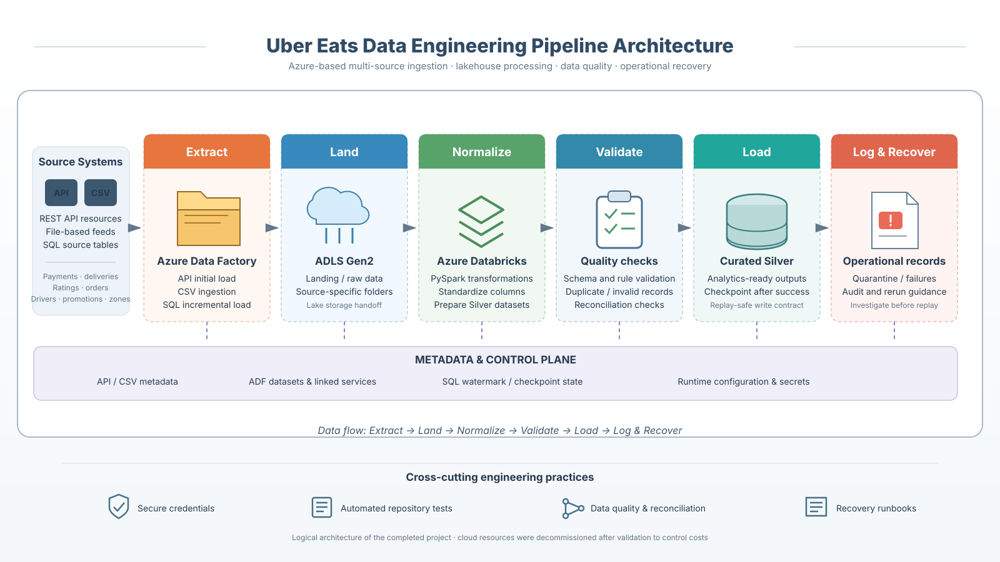

# Architecture — Uber Eats Data Engineering Platform

## 1. Purpose and scope

This document explains the architecture of the completed Uber Eats data engineering project using the repository's Python application, Azure Data Factory resource exports, storage and SQL configurations, metadata, Databricks notebook exports, tests, and operational documentation.

The platform demonstrates three source-ingestion patterns—REST API, CSV files, and SQL incremental extraction—followed by lake landing, Databricks/Spark Silver processing, a downstream Gold analytics extension, business reporting, validation, and operational recovery controls.

The diagram is a logical view of the project, not a live service map. The project owner confirms that the end-to-end implementation was successfully executed and validated. The Azure resources used during that work were subsequently decommissioned to control costs; they are not represented as currently deployed or available.

## 2. End-to-end architecture

The pipeline is presented as six logical stages:

1. **Extract** — API, CSV, and SQL ingestion patterns orchestrated through Azure Data Factory.
2. **Land** — source data is written to the configured Azure Data Lake Storage Gen2 landing area.
3. **Normalize** — Azure Databricks and PySpark notebook processing prepare source data for the Silver layer.
4. **Validate** — schema, data-quality, duplicate-handling, and reconciliation checks are applied where implemented.
5. **Load** — processed Silver outputs are produced; SQL incremental progress is advanced only after the required downstream work succeeds.
6. **Gold analytics extension** — the new Gold notebook derives order, daily performance, payment-method, driver, and restaurant-feedback datasets from Silver. This downstream layer is not drawn in the existing SVG, which is preserved as the original pipeline architecture view.
7. **Log and recover** — operational records, failure handling, and rerun guidance support investigation and recovery.

The metadata and control plane supports the flow through API/CSV metadata, ADF datasets and linked services, SQL watermark state, and environment configuration. The CSV source fixtures are staged into ADLS Gen2 before the ADF copy, so the restored CSV path does not depend on a desktop share or self-hosted Integration Runtime.

## 3. Component responsibilities

### Source systems

The project includes three source patterns:

- **REST API:** payments, deliveries, ratings, and order-status resources exposed by the FastAPI mock source.
- **CSV/files:** datasets such as drivers, promotions, and delivery zones.
- **SQL:** relational source extraction using a watermark-based incremental-load pattern.

### FastAPI source application

The main.py file implements the mock API used by the API ingestion pattern. The application includes API-key authentication, paginated resource endpoints, timestamp-based filtering, watermark information, and a controlled test-data generation endpoint.

The API key is read from the API_KEY environment variable. The application fails closed when the key is not configured; credentials should not be committed to the repository.

### Azure Data Factory

ADF resource exports define separate API, CSV, and SQL incremental ingestion pipelines, alongside supporting dataset, linked-service, and factory configuration. The CSV path is ADLS-to-ADLS and does not require a self-hosted Integration Runtime.

ADF provides orchestration and coordinates the pipeline activities. The exported JSON files are the versioned project definitions; they do not mean that an Azure Data Factory instance is currently running.

### Metadata and configuration

Metadata and configuration artifacts describe source resources, destination conventions, datasets, linked services, and runtime dependencies. This separation supports reusable ingestion patterns and reduces the need to hard-code every source detail into pipeline logic.

### Azure Data Lake Storage Gen2

The project uses an ADLS Gen2 storage integration as the landing layer between ingestion and downstream processing. Source-specific landing conventions provide the handoff to Databricks notebooks.

### Azure Databricks and PySpark

Databricks notebook exports and shared Spark utilities implement Silver-layer processing. The repository includes shared column-standardization functionality and dataset-specific notebook logic. The notebooks represent the transformation layer of the completed project.

### Gold analytics and business reporting

The downstream Gold extension is implemented in src/gold/transformations.py and notebooks/Gold_Analytics.py. It produces gold_order_360, gold_daily_order_performance, gold_payment_method_performance, gold_restaurant_feedback, and gold_driver_performance. The exported uber_eats_master ADF pipeline waits for the existing API, CSV, and SQL ingestion pipelines before invoking the Gold notebook. The business reporting SQL pack is in reports/GOLD_ANALYTICS_REPORTING.sql. The existing SVG remains unchanged and depicts the ingestion/Silver architecture; the Gold extension is documented here and in docs/GOLD_LAYER_AND_REPORTING.md.

Promotions and zones are not attributed to orders because current Silver facts do not carry validated promo_id or zone_id foreign keys. The repository contains reporting SQL but does not include a deployed Power BI dashboard.

### Data quality and operations

Supporting artifacts include data-quality and reconciliation utilities, operational SQL reports, failure-event handling, checkpoint contracts, and recovery documentation. These artifacts document how pipeline correctness and recovery are considered in addition to successful data movement.

## 4. Pipeline flow and engineering decisions

### 4.1 API ingestion

1. The API pipeline uses the configured resource metadata and dataset definitions.
2. The FastAPI source exposes the domain resources with authentication and pagination.
3. The ingestion workflow lands the extracted data in the configured lake destination.
4. Downstream processing and validation prepare the data for the Silver layer.

The API implementation includes timestamp filtering and watermark-related endpoints. Review the API source and pipeline definitions together when explaining the exact request and extraction behavior.

### 4.2 CSV ingestion

1. The three committed CSV source fixtures are staged into `bronze/csv_source` in ADLS Gen2 with SHA-256 verification.
2. `csv_metadata_proper (2).json` maps each file to its Silver landing folder.
3. ADF reads each source file from ADLS and copies it into the corresponding Bronze CSV landing folder.
4. The CSV Databricks job processes each landed file through the configured notebook dispatcher.

### 4.3 SQL incremental ingestion

The SQL incremental-load pattern uses a bounded extraction interval:

- A previously committed lower watermark defines the start of the interval.
- The pipeline captures an upper watermark for the current extraction.
- The source query extracts records above the lower watermark and up to the captured upper watermark.
- Checkpoint advancement is ordered after the required downstream Silver activity succeeds.
- The checkpoint update uses a compare-and-swap-style predicate, and the exported pipeline sets concurrency to one.

This design limits the current batch to a captured range and reduces the risk of advancing the checkpoint before downstream processing completes. It does not, by itself, guarantee complete change capture or end-to-end exactly-once processing.

Important source-specific considerations include late-arriving changes at or below the committed watermark, multiple rows sharing a watermark value, null or uninitialized checkpoints, source deletes, and replay-safe writes to the destination. A production implementation should choose a cursor strategy appropriate to the source—for example, a reliable modification timestamp, composite cursor, CDC/change tracking, or an overlap window combined with idempotent processing.

See the [SQL incremental-load review](../docs/SQL_INCREMENTAL_LOAD_REVIEW.md), [incremental source contract](../docs/INCREMENTAL_SOURCE_CONTRACT.md), and [checkpoint concurrency contract](../docs/CHECKPOINT_CONCURRENCY_CONTRACT.md).

### 4.4 Normalize, validate, and produce Silver data

Databricks notebook exports process the landed datasets using Spark. The shared Spark utility standardizes column names and rejects empty or colliding normalized names. Dataset-specific notebook logic performs the corresponding Silver-layer preparation.

Validation and reconciliation are important boundaries: malformed or duplicate records should be handled according to the relevant dataset rules, and output correctness should be assessed before incremental progress is committed.

### 4.5 Failure handling and recovery

The project includes failure logging, operational SQL, and a recovery/rerun runbook. A safe recovery process should preserve the failed run's context, inspect partial writes and checkpoint state, reconcile the affected source range, and only then decide whether to replay or resume.

See the [recovery and rerun runbook](../docs/RECOVERY_AND_RERUN_RUNBOOK.md).

## 5. Security boundaries

The project and its deployment guidance consider the following controls:

- Keep API keys, passwords, tokens, and connection strings out of source control.
- Supply secrets through environment-specific secure configuration.
- Use managed identities and a secret store such as Azure Key Vault where supported.
- Apply least-privilege access to storage, SQL, orchestration, and compute resources.
- Restrict access to API endpoints and avoid exposing sensitive source data.
- Review exported linked-service definitions before reusing them in another environment.

The presence of a Key Vault or linked-service configuration export is not, by itself, proof that every runtime connection uses secret management correctly.

## 6. Reliability and data quality considerations

The implementation and its supporting contracts address areas including:

- Bounded SQL incremental extraction and success-dependent checkpoint advancement.
- Checkpoint concurrency protection in the exported SQL pipeline pattern.
- Schema standardization and validation.
- Duplicate and invalid-record handling.
- Reconciliation and operational reporting.
- Failure investigation and controlled reruns.
- Automated repository validation through GitHub Actions.

These controls have boundaries. In particular, a watermark does not automatically capture late updates or deletes, pipeline concurrency settings do not provide a universal lock against external writers, and successful checkpoint ordering does not alone make every sink write idempotent. Those are important design considerations when adapting the project to a new production environment.

## 7. Repository validation and historical execution

The project owner confirms that the original ingestion and Silver platform was completed and successfully executed end to end before Azure resources were decommissioned to control costs. The Gold layer and master ADF pipeline are newer repository enhancements that still require a fresh Azure deployment and runtime run. The local-mode PySpark suite has passed in GitHub Actions (94 tests in [run 41846175735](https://github.com/viradidi/uber-eats-data-analytics-platform/actions/runs/41846175735)); this tests synthetic transformation behavior, not live Databricks or ADF deployment.

The repository retains implementation artifacts and repeatable checks, including API tests, local PySpark tests for Gold transformations, static ADF dependency-contract tests, and a GitHub Actions workflow that validates JSON/notebook structure, Python syntax, notebook portability, dependency installation, and the test suite. These checks do not execute live ADF or Databricks resources.

These repository checks are useful for reviewing the codebase, but they are not a substitute for a currently running Azure deployment. Current cloud resources are not available through this repository. Historical execution status is based on the project owner's confirmation; any retained run logs, screenshots, or output evidence can provide additional corroboration.

## 8. Re-deployment considerations

To recreate the platform in a new Azure environment:

1. Provision the required source, storage, orchestration, and Databricks resources.
2. Configure environment-specific credentials and secret management.
3. Review and update linked services, integration runtimes, dataset paths, and pipeline parameters.
4. Configure the FastAPI source and required network access.
5. Verify notebook dependencies, input paths, and output destinations.
6. Review SQL watermark initialization, late-arriving data, deletes, and replay semantics for each source.
7. Execute controlled test batches and reconcile source-to-target results.
8. Capture run identifiers, logs, validation outputs, and recovery evidence.

Do not commit live credentials or environment-specific secrets.

## 9. Architecture status

This is the logical architecture of a completed project whose cloud environment was later decommissioned. The SVG and exported resource definitions document the implemented design; they do not imply current cloud availability, a live production service, an SLA, or independent production certification.
